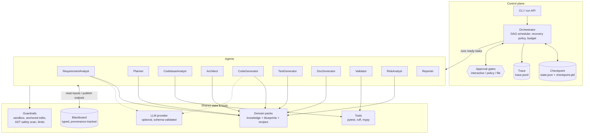
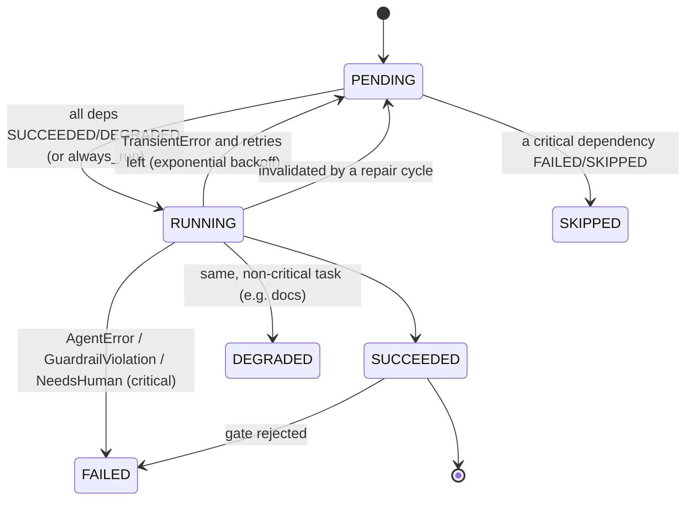
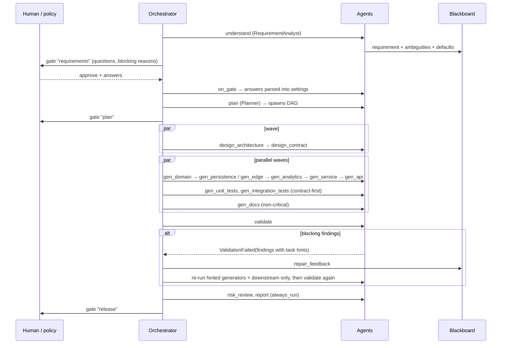

# Architecture

## 1. Goals that shaped the design

1. **End-to-end, not a chatbot.** The unit of work is a *run*: requirement in, reviewable
   outcome out, with every step recorded.
2. **Controlled autonomy.** Agents work on their own across many steps. Humans approve the things
   that are expensive to get wrong: the understanding of the requirement, the plan, the concrete
   change set (brownfield), and the release.
3. **Evidence over assertion.** Nothing counts as done because an agent says so. Code is executed,
   artifacts are checked against each other, and every acceptance criterion has to trace to a
   passing test.
4. **Recoverable.** Failures are classified and handled by policy: retry, targeted repair,
   degrade, or escalate. Runs are checkpointed and can be resumed.
5. **Deterministic by default, LLM-optional.** The full workflow runs offline and reproducibly
   (needed for evaluation and CI). LLMs extend coverage and are never trusted blindly.

## 2. Components

| Component | Responsibility | Key file |
|---|---|---|
| **Orchestrator** | Schedules the task DAG in parallel waves; applies the recovery policy; runs gates; enforces the execution budget; checkpoints after every state change; supports resume | `orchestrator.py` |
| **Blackboard** | The only channel between agents. Typed records (`NormalizedRequirement`, `Plan`, `FileChange`, `Finding`…) with per-key provenance, plus an atomic `update` for keys that parallel tasks contribute to | `context.py` |
| **Approval gates** | One interface, three modes: `interactive` (human in the terminal), `auto` (policy that approves only when nothing is blocking), `file` (recorded decisions). Agents *describe* what needs approval; they never approve their own work | `approval.py` |
| **Guardrails** | Filesystem sandbox (no absolute paths, `..`, or symlink escapes); edits anchored to text that must match exactly once; change-set and file-size caps; AST safety scan; caps on executions and repair cycles; subprocess timeouts | `guardrails.py`, `tools.py` |
| **Domain packs** | Data, not code paths: recognition keywords, capabilities and acceptance criteria, NFR dimensions (question, default, answer parser), components/test suites, architecture, ADRs, risks, a code blueprint, brownfield change recipes | `knowledge.py`, `blueprints/url_shortener/` |
| **LLM layer** | Optional Anthropic/Bedrock provider. Output must be JSON that passes a validator; the validation error is fed back once; if it still fails, the agent falls back to its deterministic path | `llm.py` |

### Agents

| Agent | Input → output | Notable behaviour |
|---|---|---|
| **RequirementAnalyst** | raw text → `NormalizedRequirement` | Classifies greenfield/brownfield/test-docs; scores domain packs (confidence); separates *stated* from *assumed* capabilities; maps vague words (*fast, secure, track stuff*) onto measurable dimensions; each question carries a default; gate answers are **parsed into settings** and invalid answers are rejected (default kept, logged) |
| **Planner** | requirement → `Plan` (spawned DAG) | **Staged planning**: brownfield gets a second planning pass *after* codebase analysis; conflict analysis runs edits to the same files one after another (bug fix first) and leaves independent work parallel |
| **CodebaseAnalyst** | repo → model + impact | AST only: internal import graph, classes/dataclass fields, functions and calls, routes (route tables, decorators, if/path dispatch), SQL tables, architectural **roles** (http/service/store/model), request **data flows**; runs the existing suite as a **baseline**; symbol-level impact with transitive callers |
| **Architect** | requirement → architecture doc, OpenAPI 3.1, SQL schema | **Contract-first**: the contract is derived from resolved settings (e.g. auth on/off changes `security` and the `401` responses) and self-checked (dangling `$ref`, path params, operationIds) before anything consumes it |
| **CodeGenerator** | contract + settings → `FileChange`s | Greenfield blueprint rendering (placeholders must all resolve); brownfield recipes that **re-read the current file**, find symbols with `ast`, and raise `NeedsHuman` rather than guess; freeform mode via LLM, or escalation |
| **TestGenerator** | acceptance criteria + contract → tests | Runs **in parallel with code generation** (tests come from the spec, not the implementation); each test declares `Covers: AC-…`, building the traceability matrix |
| **DocGenerator** | contract, settings, ADRs → docs | README endpoint table and API reference are rendered *from the contract*, so docs cannot drift from it; brownfield: CHANGELOG and reviewer change notes |
| **Validator** | workspace → report or `ValidationFailed` | Static safety, lint, types, **cross-artifact consistency** (SQL vs schema, routes vs contract, config vs approved settings), executed tests, traceability; brownfield: change scope, baseline regression, diff. Each finding carries a **task hint** used for fault localisation |
| **RiskAnalyst** | run evidence → risks, strategy | Domain risks plus run-specific ones: unconfirmed assumptions, remaining findings, missing tools, failed/degraded tasks |
| **Reporter** | blackboard + trace → summary | Assembled only from recorded state (nothing re-derived); owns the **release gate** |

## 3. Execution model and control flow

### Task lifecycle

### Run sequence (greenfield)

### Recovery policy

| Signal | Policy | Bound |
|---|---|---|
| `TransientError` (timeouts, flaky tools) | retry the same task, exponential backoff | `task.max_retries` |
| `ValidationFailed` | **repair cycle**: publish findings as feedback; invalidate the hinted generator tasks *and everything downstream of them*; re-run | `Limits.max_repair_cycles` (default 2) |
| `GuardrailViolation` | fail immediately; never retried (a retry would just repeat the unsafe action) | — |
| `NeedsHuman` | escalate: task fails with a reason; the summary lists it | — |
| non-critical task fails | `DEGRADED`; the run continues; flagged in the summary | — |
| any critical failure | dependants `SKIPPED`; `always_run` tasks (risk, report, escalation) still produce a partial, reviewable outcome | — |
| process crash | checkpoint after every state change; `resume` resets interrupted work to pending | — |
| runaway work | execution budget; tasks beyond it are skipped (except `always_run`) | `Limits.max_task_executions` |

**Fault localisation** (Validator → orchestrator), from most to least specific:

1. Static findings are tied to a file, and the file belongs to the task that last wrote it.
2. A failing test's traceback, **including captured logs**, is searched for frames in generated
   source. The innermost generated frame decides. This matters because the HTTP layer turns
   exceptions into 500 responses, so the assertion alone would point at the wrong layer.
3. With no source frame, the most downstream generated module that the failing test imports is
   blamed (the entry point the behaviour was observed through).
4. On the next cycle the scope widens to the test's whole import closure.

Demonstrated in `runs/02a-*` (schema drift localised to `gen_persistence` via logs) and
`runs/02b-*` (wrong status code localised to `gen_api` via the entry-point rule).

### Cross-step coordination (not just sequencing)

- **Contract-first fan-out:** one contract feeds code, tests and docs concurrently, and the
  validator checks the code against that same contract.
- **Settings propagation:** answers at the requirements gate → `req.settings` → contract, config
  defaults, README, architecture doc → checked by `settings_conformance`.
- **Dynamic, staged planning:** the planner spawns tasks at runtime; brownfield's concrete change
  plan is only produced after codebase analysis, behind its own gate.
- **Conflict-aware scheduling:** change tasks that edit the same files are chained in priority
  order. Each recipe re-reads the file after the previous edit, so their anchors still match.
- **Feedback loops:** validator findings flow back to specific generators, and invalidation
  ripples downstream so stale outputs never reach validation.
- **Shared accumulation:** parallel test generators merge their traceability matrices through an
  atomic blackboard update.

## 4. Key design decisions

| Decision | Choice | Why / trade-off |
|---|---|---|
| Orchestration engine | Small, framework-free DAG engine (~300 lines) | Every behaviour that is assessed (waves, retries, repair invalidation, gates, budget, resume) is visible and tested. It maps one-to-one onto LangGraph (below) if a framework is wanted. Trade-off: no built-in distributed execution |
| Agent communication | Blackboard with typed records and provenance | Agents stay decoupled and testable in isolation; provenance makes the summary auditable. Trade-off: a central shared state (fine within a run) |
| Agent intelligence | Deterministic agents + domain packs; LLM optional | Reproducible demos, tests and CI; no API key needed for evaluation. Trade-off: offline generation covers only domains with a pack, and every limit is stated in the summary |
| Edits | Anchored, exactly-once replacement of a symbol's source located with `ast` | The same discipline as reviewed code-change tools: an edit either applies cleanly or escalates. Never fuzzy. Trade-off: unfamiliar code structure → `NeedsHuman` |
| Tests | Contract-first, generated in parallel with code | Tests check the spec, not a copy of the implementation; it also shortens the critical path |
| Gate policy | Auto policy approves only when nothing is blocking; high-severity questions block | Autonomy where it is safe, a human where a guess would be expensive (e.g. what system to build) |
| Validation tools | Run in subprocesses with timeouts and a scrubbed environment; a missing tool is a reported gap | Generated code never runs inside the orchestrator process; "tool not installed" never silently counts as "passed" |

### Mapping to LangGraph / A2A

| This prototype | LangGraph equivalent |
|---|---|
| `TaskSpec` + `depends_on` | nodes + edges of a `StateGraph`; parallel waves = fan-out branches |
| Blackboard | graph `State` with reducers (`update` = reducer for shared keys) |
| `spawn` (dynamic planning) | `Send` API / sub-graphs built at runtime |
| `ValidationFailed` → repair cycle | conditional edge from `validate` back to generator nodes |
| Approval gates | `interrupt()` + `Command(resume=...)` |
| `checkpoint()` / `resume()` | checkpointer (e.g. Postgres/DynamoDB saver) + thread id |
| Agents | node functions, or A2A remote agents behind the same input/output records |

## 5. LLM integration

`--llm anthropic` (or `SDLC_LLM=anthropic`, `SDLC_LLM_MODEL=...`) / `--llm bedrock` enables:

- **RequirementAnalyst**: an extra ambiguity pass. Results are schema-validated, de-duplicated,
  and merged as `L*` questions that go through the same gate.
- **CodeGenerator (freeform)**: generation for domains with no pack. The output is a list of
  `FileChange`s that is validated, sandboxed, and then held to exactly the same validator as
  pack output. On a repair cycle the findings for the task are included in the prompt.

LLM output never bypasses the guardrails, the validator, or the gates.

## 6. Path to production (AWS)

| Concern | Prototype | Production |
|---|---|---|
| Orchestration | in-process thread pool | LangGraph on ECS Fargate, or Step Functions (Map state for waves) |
| Checkpoints / state | pickle + JSON on disk | DynamoDB checkpointer; artifacts in S3 (versioned) |
| Code execution | subprocess with timeout | ephemeral sandbox per validation (Fargate task / Firecracker), no network, read-only base image |
| Human gates | terminal / YAML | Step Functions task tokens or LangGraph interrupts surfaced as PR reviews / Slack approvals |
| Trace / audit | JSONL | CloudWatch Logs + OpenTelemetry spans per task; immutable audit bucket |
| LLM | Anthropic / Bedrock client | Bedrock with guardrails, per-run token budget, prompt/response logging |
| Output | workspace folder | branch + pull request with the engineering summary as the PR description |
