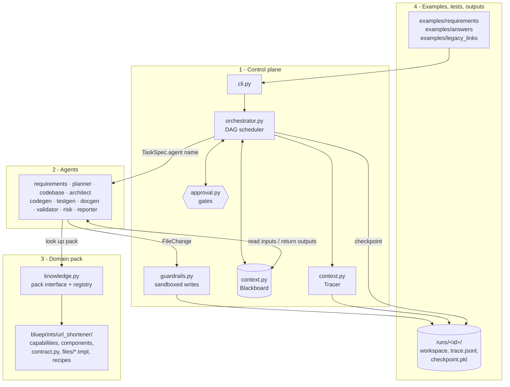
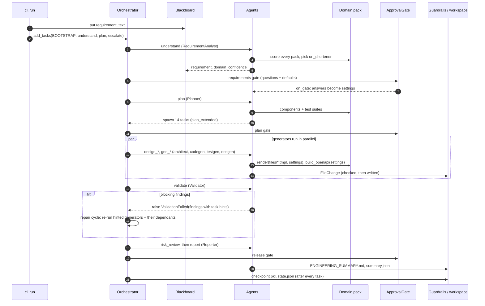

# How the pieces connect

This document follows one run through the code: which module calls which, what
passes between them, and where each output comes from. For *why* the system is
designed this way, see [ARCHITECTURE.md](ARCHITECTURE.md).

## 1. Four layers

The repo has four layers:

1. a **control plane** that runs the workflow;
2. **agents** that do the work;
3. a **domain pack** that holds the URL-shortener knowledge;
4. **examples, tests and outputs**.

| Layer | Where | Responsibility | Knows about |
|---|---|---|---|
| **Control plane** | [`cli.py`](../sdlc_agent/cli.py), [`orchestrator.py`](../sdlc_agent/orchestrator.py), [`context.py`](../sdlc_agent/context.py), [`approval.py`](../sdlc_agent/approval.py), [`guardrails.py`](../sdlc_agent/guardrails.py) | Schedules tasks, retries and repairs them, asks for approvals, sandboxes writes, checkpoints, traces | Tasks and agent *names*; nothing about URL shorteners |
| **Agents** | [`agents/`](../sdlc_agent/agents/) | Each one does one kind of work: understand, plan, design, generate, validate, assess risk, report | The blackboard and the domain-pack *interface* ([`knowledge.py`](../sdlc_agent/knowledge.py)) |
| **Domain pack** | [`blueprints/url_shortener/`](../sdlc_agent/blueprints/url_shortener/) | Capabilities and acceptance criteria, clarifying questions, components, OpenAPI builder, code templates, brownfield recipes, risks | Only its own domain; it is data, not workflow |
| **Examples, tests, outputs** | [`examples/`](../examples/), [`tests/`](../tests/), [`runs/`](../runs/) | Inputs to run, tests of the system itself, and committed results of the demo runs | Everything above, from the outside |

Dependencies point one way only: the control plane never imports an agent's internals, and agents never
import the URL-shortener pack directly. They look it up through
[`knowledge.py`](../sdlc_agent/knowledge.py). A second domain is a new folder under `blueprints/`;
no control-plane code changes.

## 2. The connectors

The layers communicate through six objects. Everything else is internal to one module.

| Connector | Defined in | What flows through it |
|---|---|---|
| `TaskSpec` | [`models.py`](../sdlc_agent/models.py) | One unit of work: id, **agent name**, dependencies, optional gate, criticality, `always_run`, params. The orchestrator only ever schedules `TaskSpec`s. |
| `AgentResult` | [`agents/base.py`](../sdlc_agent/agents/base.py) | What an agent returns: `outputs` (published to the blackboard), `spawn` (new tasks: how the plan grows), `notes` (for the summary). |
| `Blackboard` | [`context.py`](../sdlc_agent/context.py) | Shared state between agents. Every `put` records which task produced the key (provenance). Agents never call each other; they read what earlier tasks published. |
| `RunContext` | [`orchestrator.py`](../sdlc_agent/orchestrator.py) | Handed to every agent: the blackboard, tracer, approval gate, guardrails, fault injector, optional LLM provider and options. |
| `FileChange` → `Guardrails.apply()` | [`guardrails.py`](../sdlc_agent/guardrails.py) | **The only way an agent writes a file.** Each change is checked: path stays in the workspace, size and change-count limits, unique anchors for edits, static safety scan of Python. |
| `DomainPack` | [`knowledge.py`](../sdlc_agent/knowledge.py) | The interface between generic agents and domain knowledge. `packs()` imports and registers the built-in packs; `get_pack` / `require_pack` look one up; `render()` fills a template's `{{ setting }}` placeholders. |

## 3. One run, step by step

A greenfield run: `python -m sdlc_agent run -f examples/requirements/greenfield_url_shortener.md`.

The same steps, mapped to the code:

| # | Step | Code | Blackboard / trace |
|---|---|---|---|
| 1 | Read the requirement, create `runs/<id>/`, build the `RunContext` (workspace, tracer, gate, guardrails, faults, LLM) | `cli.run`, `cli.make_context` | `requirement_text` (producer `user`) |
| 2 | Seed the plan with three bootstrap tasks | `cli.BOOTSTRAP`, `Orchestrator.add_tasks` | `run_started` |
| 3 | Main loop: start every ready task in a thread pool, wait for one to finish, apply the result, checkpoint | `Orchestrator.run`, `_schedule`, `_readiness`, `_on_complete`, `checkpoint` | `task_started` / `task_succeeded` |
| 4 | **Understand**: classify greenfield/brownfield, score every domain pack, map stated and assumed capabilities to acceptance criteria, raise questions with defaults | `agents/requirements.py` → `knowledge.packs()`, `DomainPack.score` | `requirement`, `domain_confidence` |
| 5 | **Requirements gate**: the gate (not the agent) decides; answers are parsed into settings such as `code_length` | `Orchestrator._gate` → `ApprovalGate.decide` → `Agent.on_gate` | `gate_requested`, `gate_decided`, `gate_decisions` |
| 6 | **Plan**: turn the pack's components and test suites into a dependency graph, then pass the plan gate | `agents/planner.py` (`_greenfield`) | `plan_extended` (14 tasks added) |
| 7 | **Design**: architecture document and ADRs, then the OpenAPI contract built from the resolved settings | `agents/architect.py` → `contract.build_openapi` | files under `project/docs/`, `openapi.yaml/json` |
| 8 | **Generate**, in parallel waves: code per component, tests per suite, docs | `agents/codegen.py`, `testgen.py`, `docgen.py` → `knowledge.render` | every write goes through `Guardrails.apply` |
| 9 | **Validate**: syntax, safety scan, lint, types, schema, contract and settings conformance, executed tests, traceability (criterion → tests) | `agents/validator.py` → `tools.py` (pytest, ruff, mypy) | `review/validation_report.json` |
| 10 | **Risk review**: pack risks plus any assumptions nobody confirmed | `agents/risk.py` | risks for the summary |
| 11 | **Report**, then the **release gate** | `agents/reporter.py` | `ENGINEERING_SUMMARY.md`, `summary.json`, `run_finished` |

The `escalate` task always runs (`always_run=True`). When planning succeeds it does nothing; when the
run stops early (for example, the requirements gate rejects), it writes a partial summary, so every
run leaves something to review.

## 4. The three feedback loops

The flow above is the happy path. Three loops make it self-correcting, and all three live in
[`orchestrator.py`](../sdlc_agent/orchestrator.py):

| Loop | Trigger | What happens | Trace event | Demo run |
|---|---|---|---|---|
| **Retry** | An agent raises `TransientError` | Back to `PENDING` with exponential backoff, up to `max_retries` | `task_retry` | `runs/02a-recovery-schema-drift` |
| **Targeted repair** | The validator raises `ValidationFailed`; each finding names the generator that produced the faulty file | `_repair` re-runs only those generators plus their dependants (`downstream`), with the findings on the blackboard as `repair_feedback`; capped by `max_repair_cycles` | `repair_cycle` | `runs/02a-…`, `runs/02b-recovery-api-defect` |
| **Human gate** | A task declares `gate=` | `_gate` asks the `ApprovalGate` (interactive, recorded file, or auto policy). Rejection fails the task, and its dependants are skipped | `gate_requested`, `gate_decided` | `runs/04a-ambiguous-escalated`, `runs/04b-ambiguous-answered` |

Two more controls sit around them:

- **Failure handling:** `_fail` marks a critical task `FAILED` (which fails the run) and a
  non-critical one `DEGRADED` (the run continues).
- **Budget and safety limits:** these are enforced by `Guardrails`. A guardrail violation is never
  retried.

After every finished task, `checkpoint()` saves the whole state. `cli.resume` → `Orchestrator.resume`
continues a crashed run without redoing finished work (`runs/05-crash-resume`).

## 5. Where the domain pack plugs in

Agents ask the pack for knowledge at each step. This is the full list of touch points:

| Agent | Uses from the pack |
|---|---|
| RequirementAnalyst | `keywords` (recognition score), `capabilities` and acceptance criteria, `dimensions` (questions, defaults, answer parsers, settings), `brownfield_recipes` (to recognise change requests) |
| CodebaseAnalyst | `brownfield_recipes` (which recipes apply to the target repo) |
| Planner | `components` and `test_suites` (with their dependencies), `brownfield_recipes` (ordered change tasks) |
| Architect | `architecture` decisions (become ADRs), `tradeoffs`, `build_contract` (OpenAPI) |
| CodeGenerator / TestGenerator | template files under `files/` (via `render`), `brownfield_recipes` (anchored edits and regression tests), `bug_variants` (fault-injection demo only) |
| DocGenerator | `tradeoffs`, `brownfield_recipes` (change notes) |
| RiskAnalyst | `risks`, `architecture` |
| Reporter | `capabilities` (for the summary) |

An unknown domain has no pack. The requirement is still analysed and planned, but generation raises
`NeedsHuman` (escalation) unless an LLM provider is configured.

## 6. Outputs and how they trace back

| File in `runs/<id>/` | Written by | Shows |
|---|---|---|
| `requirement.md` | `cli.run` | The exact input |
| `trace.jsonl` | `Tracer.emit` (every step above) | The full ordered history: tasks, retries, repairs, gates |
| `checkpoint.pkl`, `state.json` | `Orchestrator.checkpoint` | Task records, plan and blackboard; used by `resume` |
| `workspace/project/` | generators via `Guardrails.apply` | The generated service, tests and docs |
| `workspace/review/` | validator (and codebase analyst for brownfield) | Validation report, impact analysis, `changes.patch` |
| `workspace/ENGINEERING_SUMMARY.md` | reporter | Decomposition, plan diagram, trace, validation, risks, oversight log |

## 7. Tests map onto the layers

| Test file | Layer it proves |
|---|---|
| [`tests/test_orchestrator.py`](../tests/test_orchestrator.py) | Control plane: scheduling, parallelism, retries, repair, gates, budget, crash/resume (uses fake agents) |
| [`tests/test_guardrails_and_gates.py`](../tests/test_guardrails_and_gates.py) | Control plane: sandbox, safety scan, approval modes, LLM output validation |
| [`tests/test_agents.py`](../tests/test_agents.py) | Agents plus the domain pack: understanding, questions, settings, codebase analysis, fault localisation |
| [`tests/test_end_to_end.py`](../tests/test_end_to_end.py) | All four layers together, through `cli.run` |
| `runs/<id>/workspace/project/tests/` | The generated service itself (contract, API, persistence, concurrency, units) |
