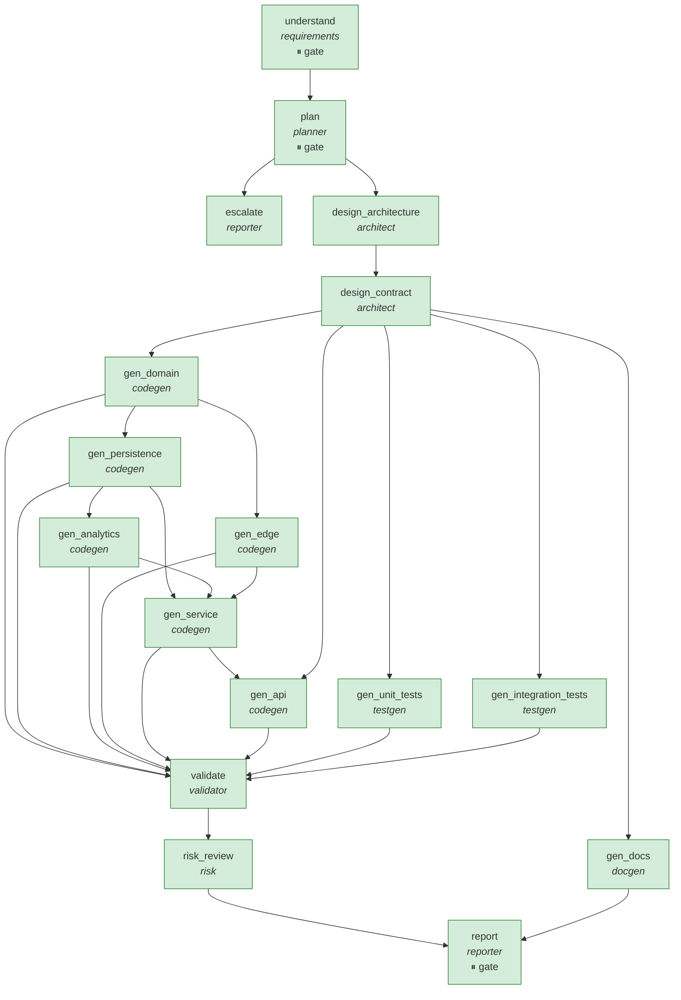

# Engineering summary - Build a scalable URL shortener service with APIs, persistence, and analytics

**Run:** `01-greenfield`  |  **Outcome:** READY FOR REVIEW  |  **Scenario:** greenfield  |  **Domain:** url_shortener  |  **LLM:** none (deterministic agents)

**Release gate:** APPROVED by `policy:auto`

## 1. Requirement understanding

> Build a scalable URL shortener service with APIs, persistence, and analytics.

**Normalised:** Build a new URL shortener service: Create a short link for a long URL; Durable storage of links and analytics; Click analytics per link; Horizontal scalability of the redirect path; Versioned REST API with a published contract. Also assumed: 5 capabilities required for production use.

**Capabilities**
- Create a short link for a long URL (stated)
- Durable storage of links and analytics (stated)
- Click analytics per link (stated)
- Horizontal scalability of the redirect path (stated)
- Versioned REST API with a published contract (stated)
- Resolve a short code and redirect (HTTP 302) (assumed)
- Reject unsafe or malformed target URLs (assumed)
- Optional custom alias (vanity code) (assumed)
- Optional link expiry (TTL) (assumed)
- Rate limiting and API-key protection of write endpoints (assumed)

**Out of scope (v1):** User accounts / UI dashboard; Geo-IP enrichment; Custom domains per tenant; Malware/phishing reputation lookups (documented as production follow-up)

**Acceptance criteria**

| ID | Type | Criterion |
|---|---|---|
| AC-CREATE | functional | POST /api/v1/links with a valid http(s) URL returns 201 with a unique short code and short_url |
| AC-REDIRECT | functional | GET /{code} returns 302 with Location set to the original URL; unknown codes return 404 |
| AC-VALIDATE | security | Non-http(s), credential-bearing, local or private-network target URLs are rejected with 422 |
| AC-ALIAS | functional | A custom alias can be requested; a taken alias returns 409 and never overwrites the existing link |
| AC-EXPIRY | functional | Links may carry a TTL; expired links return 410 Gone |
| AC-PERSIST | functional | Links and analytics survive a process restart |
| AC-ANALYTICS | functional | Every redirect records a click; the stats endpoint returns totals, per-day counts, top referrers and user-agent classes |
| AC-PRIVACY | security | Raw client IPs and full referrer URLs are never stored; raw events are purgeable after the retention window |
| AC-CONCURRENCY | nfr | Code allocation is collision-safe under concurrent writers (no duplicate codes, no lost or overwritten links) |
| AC-HOTPATH | nfr | Redirects are served from cache after first access and analytics recording never blocks or fails a redirect |
| AC-ABUSE | security | Link creation is rate limited per client (429 + Retry-After); write endpoints require an API key when configured; only owners can disable a link |
| AC-CONTRACT | functional | The HTTP API conforms exactly to the published OpenAPI contract; errors use application/problem+json |

### Ambiguities and resolutions

| ID | Severity | Trigger | Question | Resolution | Source |
|---|---|---|---|---|---|
| Q1 | medium | scalable | 'scalable' is not measurable. What peak redirect throughput and total link volume must the service support? | Design target 10k redirects/s peak, 100 creates/s, ~1B links over 5 years (read:write ~ 100:1). The prototype is sized for one node; the design scales out. | default assumption |
| Q2 | low | latency objective | What latency objective applies to redirects? | p99 redirect latency < 50 ms inside the service (cache hit < 5 ms). | default assumption |
| Q3 | low | availability objective | What availability target applies, and may link creation degrade before redirects? | 99.95% for redirects; creation and analytics may degrade first (analytics is best-effort and must never block redirects). | default assumption |
| Q4 | low | write access control | Who may create and delete links? Is an API key required for write endpoints? | Write endpoints require an API key (X-API-Key); redirects and stats are public. | default assumption |
| Q5 | low | analytics privacy | Which visitor data may analytics store? (raw IPs are personal data under GDPR) | Never store raw IPs: keep a salted, daily-rotating hash for unique-visitor counts. | default assumption |
| Q6 | low | analytics retention | How long must raw click events be retained? | Raw click events 90 days; daily aggregates kept for the life of the link. | default assumption |
| Q7 | low | analytics dimensions | Which analytics are required (clicks, uniques, referrers, devices, geography)? | Total and daily clicks, unique visitors, top referrer hosts, user-agent class. Geo-IP is out of scope for v1 (needs a licensed database). | default assumption |
| Q8 | low | abuse limits | What creation rate per client is acceptable before throttling? | 60 link creations per minute per API key (or per IP when keys are disabled). | default assumption |
| Q9 | low | short-code format | How long may short codes be, and must they be unguessable? | 7-character random base62 codes (62^7 = 3.5e12), unguessable, no sequential IDs. | default assumption |
| Q10 | low | default expiry | Should links expire by default? If so after how many days? | Links never expire unless the caller sets ttl_seconds. | default assumption |
| Q11 | low | custom aliases | Are caller-chosen custom aliases allowed? | Yes - custom aliases allowed, first-come-first-served, never overwritten. | default assumption |

Resolved settings fed to generation: `allow_custom_alias=True`, `analytics_ip_mode=hash`, `analytics_retention_days=90`, `code_length=7`, `create_rate_per_min=60`, `default_ttl_days=0`, `require_api_key=True`

## 2. Implementation plan and rationale

- **Planning stage 1:** Contract-first decomposition: architecture -> contract -> parallel component generation (DAG by import dependencies) || contract-driven test generation || docs -> validation with repair loop -> risk review -> engineering summary + release gate.

| Task | Agent | Depends on | Status | Attempts | ms | Notes |
|---|---|---|---|---|---|---|
| `understand` | requirements | - | succeeded | 1 | 10 | kind=greenfield domain=url_shortener confidence=1.00; 5 stated / 5 assumed capabilities, 11 ambiguities, 12 acceptance criteria |
| `plan` | planner | understand | succeeded | 1 | 1 | 14 tasks planned (initial) |
| `escalate` | reporter | plan | succeeded | 1 | 1 | not needed: plan approved, full report will follow |
| `design_architecture` | architect | plan | succeeded | 1 | 4 | 8 components, 7 ADRs |
| `design_contract` | architect | design_architecture | succeeded | 1 | 18 | 6 operations, 3 tables |
| `gen_domain` | codegen | design_contract | succeeded | 1 | 25 | 5 file change(s): project/shortener/__init__.py, project/shortener/codes.py, project/shortener/config.py, project/shortener/domain.py, project/shortener/errors.py |
| `gen_persistence` | codegen | gen_domain | succeeded | 1 | 11 | 1 file change(s): project/shortener/repository.py |
| `gen_analytics` | codegen | gen_persistence | succeeded | 1 | 24 | 1 file change(s): project/shortener/analytics.py |
| `gen_edge` | codegen | gen_domain | succeeded | 1 | 38 | 2 file change(s): project/shortener/cache.py, project/shortener/ratelimit.py |
| `gen_service` | codegen | gen_persistence, gen_analytics, gen_edge | succeeded | 1 | 2 | 1 file change(s): project/shortener/service.py |
| `gen_api` | codegen | gen_service, design_contract | succeeded | 1 | 7 | 3 file change(s): project/pyproject.toml, project/shortener/http.py, project/shortener/main.py |
| `gen_unit_tests` | testgen | design_contract | succeeded | 1 | 61 | 32 test functions across 8 files; covers 10 acceptance criteria |
| `gen_integration_tests` | testgen | design_contract | succeeded | 1 | 33 | 21 test functions across 4 files; covers 11 acceptance criteria |
| `gen_docs` | docgen | design_contract | succeeded | 1 | 64 | 10 documents |
| `validate` | validator | gen_domain, gen_persistence, gen_analytics, gen_edge, gen_service, gen_api, gen_unit_tests, gen_integration_tests | succeeded | 1 | 3870 | tests 90/90 passed; 0 non-blocking finding(s) |
| `risk_review` | risk | validate | succeeded | 1 | 1 | 9 risks (1 from unconfirmed assumptions) |
| `report` | reporter | risk_review, gen_docs | succeeded | 1 | 37 | summary written; status=ready_for_review |

## 3. Orchestration trace

- 17 task executions, max parallelism 5, 0 transient retries, 0 repair cycle(s), 3 human/policy gate decisions

| t (s) | Event | Detail |
|---|---|---|
| 0.014 | gate_decided | gate=requirements, approved=True, by=policy:auto, comment=accepted 11 default assumption(s); flagged in summary |
| 0.022 | gate_decided | gate=plan, approved=True, by=policy:auto, comment= |
| 0.022 | plan_extended | by=plan, added=['design_architecture', 'design_contract', 'gen_domain', 'gen_persistence', 'gen_analytics', 'gen_edge', 'gen_service', 'gen_api', 'gen_unit_tests', 'gen_integration_tests', 'gen_docs', 'validate', 'risk_review', 'report'] |
| 4.083 | gate_decided | gate=release, approved=True, by=policy:auto, comment= |

Full machine-readable trace: `trace.jsonl`.

## 5. Generated artifacts

| Path | Produced by | Lines | sha256 |
|---|---|---|---|
| `project/README.md` | gen_docs | 61 | `0a26b6dbdc36` |
| `project/docs/API.md` | gen_docs | 70 | `d66a67e4ef92` |
| `project/docs/RUNBOOK.md` | gen_docs | 23 | `699faf529156` |
| `project/docs/adr/ADR-001.md` | gen_docs | 12 | `098f88df92c4` |
| `project/docs/adr/ADR-002.md` | gen_docs | 12 | `cfa965601268` |
| `project/docs/adr/ADR-003.md` | gen_docs | 12 | `354fdec45fab` |
| `project/docs/adr/ADR-004.md` | gen_docs | 12 | `67d30f1850f3` |
| `project/docs/adr/ADR-005.md` | gen_docs | 12 | `e44172d7a152` |
| `project/docs/adr/ADR-006.md` | gen_docs | 12 | `a2fb6068e997` |
| `project/docs/adr/ADR-007.md` | gen_docs | 12 | `fb48741514af` |
| `project/openapi.json` | design_contract | 458 | `746e3153864a` |
| `project/openapi.yaml` | design_contract | 273 | `a341e818866e` |
| `project/pyproject.toml` | gen_api | 16 | `63e62c8aa5a0` |
| `project/shortener/__init__.py` | gen_domain | 2 | `dadb67928979` |
| `project/shortener/analytics.py` | gen_analytics | 264 | `12765146bec3` |
| `project/shortener/cache.py` | gen_edge | 78 | `353379f6312e` |
| `project/shortener/codes.py` | gen_domain | 61 | `12c352ecae4e` |
| `project/shortener/config.py` | gen_domain | 107 | `bed1dc580d74` |
| `project/shortener/domain.py` | gen_domain | 140 | `3172d4ebc23b` |
| `project/shortener/errors.py` | gen_domain | 83 | `cd5a11f3b385` |
| `project/shortener/http.py` | gen_api | 278 | `8d19a17c9575` |
| `project/shortener/main.py` | gen_api | 83 | `01d98d391c54` |
| `project/shortener/ratelimit.py` | gen_edge | 58 | `2d4b678e9f9a` |
| `project/shortener/repository.py` | gen_persistence | 128 | `5a91831361ff` |
| `project/shortener/schema.sql` | design_contract | 37 | `350440915a43` |
| `project/shortener/service.py` | gen_service | 165 | `a58cf8d25b46` |
| `project/tests/__init__.py` | gen_unit_tests | 0 | `e3b0c44298fc` |
| `project/tests/conftest.py` | gen_unit_tests | 68 | `1b5d53ea428e` |
| `project/tests/integration/__init__.py` | gen_integration_tests | 0 | `e3b0c44298fc` |
| `project/tests/integration/test_api.py` | gen_integration_tests | 157 | `eebbfd978e57` |
| `project/tests/integration/test_contract.py` | gen_integration_tests | 56 | `80c10d56b2d8` |
| `project/tests/integration/test_persistence_and_concurrency.py` | gen_integration_tests | 101 | `49e7c2466478` |
| `project/tests/support.py` | gen_unit_tests | 67 | `e55fa2bad31b` |
| `project/tests/unit/__init__.py` | gen_unit_tests | 0 | `e3b0c44298fc` |
| `project/tests/unit/test_analytics_recorder.py` | gen_unit_tests | 70 | `a97520581bd4` |
| `project/tests/unit/test_cache_and_ratelimit.py` | gen_unit_tests | 79 | `f611c7bc3fad` |
| `project/tests/unit/test_domain_and_codes.py` | gen_unit_tests | 110 | `ba7c0683c672` |
| `project/tests/unit/test_service.py` | gen_unit_tests | 139 | `33547a2a5898` |

## 6. Validation results

- **Overall:** PASSED (0 blocking, 0 total findings)
- **Tests:** 90/90 passed, 0 failed, 0 errors (0.71s)
- **Checks run:** syntax, static_safety, lint, types, schema_conformance, contract_conformance, settings_conformance, tests, traceability
- **ruff:** not installed (gap)
- **mypy:** not installed (gap)

**Traceability (acceptance criterion -> tests)**

| AC | Tests |
|---|---|
| AC-CREATE | 2: `test_create_returns_201_with_short_url`, `test_create_and_resolve` |
| AC-REDIRECT | 3: `test_redirect_returns_302_to_target`, `test_unknown_code_returns_problem_json_404`, `test_create_and_resolve` |
| AC-VALIDATE | 6: `test_unsafe_url_rejected_with_422`, `test_overlong_url_rejected`, `test_unsafe_or_malformed_urls_are_rejected`, `test_url_normalisation_lowercases_scheme_and_host` ... |
| AC-ALIAS | 5: `test_alias_conflict_returns_409_and_keeps_original`, `test_concurrent_alias_race_has_exactly_one_winner`, `test_invalid_or_reserved_alias`, `test_valid_alias` ... |
| AC-EXPIRY | 4: `test_expired_link_returns_410`, `test_default_ttl_applied_when_configured`, `test_invalid_ttl_rejected`, `test_ttl_expiry` |
| AC-PERSIST | 2: `test_concurrent_creates_produce_unique_codes`, `test_links_and_clicks_survive_restart` |
| AC-ANALYTICS | 6: `test_clicks_are_counted_in_stats`, `test_links_and_clicks_survive_restart`, `test_async_recorder_batches_and_flushes`, `test_background_flush_interval` ... |
| AC-PRIVACY | 5: `test_clicks_are_counted_in_stats`, `test_retention_purge`, `test_ip_anonymisation_modes`, `test_referrer_is_reduced_to_host` ... |
| AC-CONCURRENCY | 5: `test_concurrent_alias_race_has_exactly_one_winner`, `test_concurrent_creates_produce_unique_codes`, `test_code_generator_length_and_alphabet`, `test_code_space_exhaustion_is_reported` ... |
| AC-HOTPATH | 8: `test_async_recorder_batches_and_flushes`, `test_full_queue_drops_instead_of_blocking`, `test_store_failure_does_not_crash_flusher`, `test_cache_hit_miss_and_expiry` ... |
| AC-ABUSE | 6: `test_create_is_rate_limited`, `test_delete_disables_link`, `test_write_requires_api_key_when_enabled`, `test_secured_operations_match_auth_flags` ... |
| AC-CONTRACT | 9: `test_create_returns_201_with_short_url`, `test_health`, `test_malformed_requests`, `test_stats_rejects_non_integer_days` ... |

## 7. Risks, trade-offs and failure scenarios

| ID | Risk | Likelihood | Impact | Mitigation |
|---|---|---|---|---|
| R-ABUSE | Service used for phishing / malware redirection | high | high | URL safety validation, API keys, per-key rate limits, owner disable; add Safe Browsing lookup + WAF bot rules in production |
| R-ENUM | Enumeration of short codes exposing private links | medium | medium | Random 7+ char codes (3.5e12 space), negative caching, WAF rate rules on 404 bursts |
| R-HOTKEY | Viral link creates a hot partition / cache stampede | medium | high | Read-through cache in front of the store; DynamoDB adaptive capacity; request coalescing (future) for cold misses |
| R-ANALYTICS-LOSS | Click events lost under overload or crash (in-memory buffer) | medium | low | Bounded queue with drop counters on /healthz; flush on SIGTERM; durable stream (Kinesis) in prod |
| R-PRIVACY | Analytics retaining personal data beyond purpose | low | high | No raw IPs, referrer reduced to host, retention purge for raw events |
| R-SINGLE-NODE | Prototype uses SQLite and in-process cache/limiter (single node) | high | medium | All are behind ports; production adapters listed in the architecture; limiter must move to a shared store before scaling out |
| R-ASSUME-1 | Assumption not confirmed by a human: scalable | medium | medium | Defaulted to: Design target 10k redirects/s peak, 100 creates/s, ~1B links over 5 years (read:write ~ 100:1). The prototype is sized for one node; the design scales out.. Confirm before production; the value is configurable. |
| R-TOOL-ruff | Validation gap: ruff not installed | low | low | Install ruff in CI; its checks did not run |
| R-TOOL-mypy | Validation gap: mypy not installed | low | low | Install mypy in CI; its checks did not run |

| Decision | Chosen | Alternatives | Rationale |
|---|---|---|---|
| Short-code allocation | Random base62 (CSPRNG) + uniqueness constraint + bounded retry | Global counter + base62; hash(url) truncation; pre-allocated key ranges (KGS) | No coordinator or hot counter, codes are unguessable (no enumeration), collisions are detectable atomically by the store. Cost: one extra write attempt in ~1e-3 cases at 1B links. |
| Redirect status code | 302 Found | 301 Moved Permanently | 301 is cached by browsers forever, so clicks after the first are invisible to analytics and disabling/expiring a link would not take effect. 302 costs one round-trip per click. |
| Analytics write path | Asynchronous bounded queue, batch writes, drop on overload | Synchronous write per redirect; exactly-once streaming | Redirect latency/availability is the product; analytics is best-effort. Drops are counted and exposed on /healthz so loss is observable, not silent. |
| Analytics storage model | Raw events (bounded retention) + pre-aggregated daily counters | Raw events only; aggregates only | Totals stay O(days) to query and survive raw-event purging (privacy/retention); raw window still supports referrer/UA breakdowns. |
| Primary store | Key-value semantics behind a port (SQLite in prototype, DynamoDB in prod) | Relational DB (Aurora) with sharding | Access pattern is single-key get/put at very high read volume; KV gives predictable latency and horizontal scale without sharding logic. |
| Visitor privacy | Salted daily-rotating IP hash (or drop) | Store raw IPs | Unique-visitor counts without retaining personal data or enabling cross-day tracking. |
| Framework | Standard-library WSGI adapter | FastAPI/Starlette | Zero runtime dependencies for the prototype and fully in-process tests; the adapter is thin (one module) and can be swapped without touching service or storage code. |

| Failure scenario | Designed behaviour |
|---|---|
| Link store unavailable | Cached links keep redirecting; uncached -> 5xx; creates fail fast. Prod: multi-AZ DynamoDB, alarms on throttles/errors. |
| Analytics store slow/down | Redirects unaffected (bounded queue); events dropped and counted on /healthz; flusher survives write errors. |
| Code collision storm | Bounded retry (5) then 503 code_space_exhausted - signals code length is too short for volume instead of looping. |
| Duplicate alias race | Storage uniqueness constraint arbitrates; exactly one writer wins, others get 409 - verified by a concurrent test. |
| Link disabled while cached on other nodes | Local cache is invalidated immediately; other nodes converge within cache TTL (60s). Prod: publish invalidations or lower TTL. |
| Abusive client | Per-key token bucket returns 429 with Retry-After; owner can disable links. |
| Process crash | Up to one flush interval of click events lost (in-memory buffer); links are durable. Prod: durable stream (Kinesis) closes the gap. |

## 8. Validation approach

**Automated (this run)**
- Static: syntax, safety scan (eval/shell/SQL injection/secrets), ruff, mypy
- Cross-artifact: SQL vs data schema, routes vs OpenAPI contract, config vs approved requirement settings
- Unit tests: domain validation, code generation, cache, rate limiter, service rules, analytics pipeline
- Integration tests: HTTP API over real SQLite, contract conformance, durability across restart, concurrent writers (unique codes, alias race)
- Traceability: every acceptance criterion covered by at least one passing test

**Pre-production**
- Load test (k6/Locust) at 2x target peak: redirect p99 < 50 ms, 0 errors, cache hit > 90%
- Soak test 24h: memory flat, analytics backlog bounded
- Chaos: stop analytics store (redirects unaffected), throttle link store (graceful 5xx)
- Security: DAST on API, abuse simulation against rate limits

**Production**
- Canary 5% with automated rollback on p99/5xx SLO burn
- Synthetic probes: create -> redirect -> stats every minute per region
- Dashboards/alerts from RUNBOOK.md

## 9. Assumptions and limitations

- Assumed (Q1): Design target 10k redirects/s peak, 100 creates/s, ~1B links over 5 years (read:write ~ 100:1). The prototype is sized for one node; the design scales out.
- Assumed (Q2): p99 redirect latency < 50 ms inside the service (cache hit < 5 ms).
- Assumed (Q3): 99.95% for redirects; creation and analytics may degrade first (analytics is best-effort and must never block redirects).
- Assumed (Q4): Write endpoints require an API key (X-API-Key); redirects and stats are public.
- Assumed (Q5): Never store raw IPs: keep a salted, daily-rotating hash for unique-visitor counts.
- Assumed (Q6): Raw click events 90 days; daily aggregates kept for the life of the link.
- Assumed (Q7): Total and daily clicks, unique visitors, top referrer hosts, user-agent class. Geo-IP is out of scope for v1 (needs a licensed database).
- Assumed (Q8): 60 link creations per minute per API key (or per IP when keys are disabled).
- Assumed (Q9): 7-character random base62 codes (62^7 = 3.5e12), unguessable, no sequential IDs.
- Assumed (Q10): Links never expire unless the caller sets ttl_seconds.
- Assumed (Q11): Yes - custom aliases allowed, first-come-first-served, never overwritten.
- Generation ran with deterministic agents and a curated domain pack; an LLM provider (SDLC_LLM) is only needed for domains without a pack.
- Prototype adapters are single-node (SQLite, in-process cache and rate limiter); production adapters are specified in docs/architecture.md, not implemented.

## 10. Human oversight log

| Gate | Decision | By | Comment |
|---|---|---|---|
| requirements | approved | policy:auto | accepted 11 default assumption(s); flagged in summary |
| plan | approved | policy:auto |  |
| release | approved | policy:auto |  |
