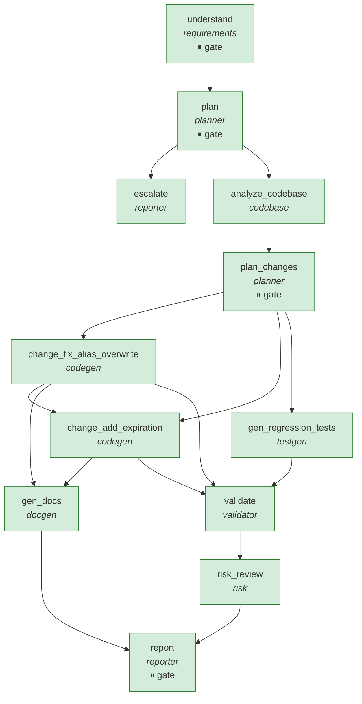

# Engineering summary - In the existing legacy-links service, add link expiration support: callers can pass an

**Run:** `03-brownfield`  |  **Outcome:** READY FOR REVIEW  |  **Scenario:** brownfield  |  **Domain:** url_shortener  |  **LLM:** none (deterministic agents)

**Release gate:** APPROVED by `policy:auto`

## 1. Requirement understanding

> In the existing legacy-links service, add link expiration support: callers can pass an
optional TTL when creating a link, and expired links must stop redirecting. Also fix the bug
where creating a link with a custom alias that already exists silently overwrites the
original link.

**Normalised:** Change an existing URL shortener service: Fix: custom alias silently overwrites an existing link; Feature: optional link expiration (TTL).

**Capabilities**
- Fix: custom alias silently overwrites an existing link (stated)
- Feature: optional link expiration (TTL) (stated)

**Out of scope (v1):** User accounts / UI dashboard; Geo-IP enrichment; Custom domains per tenant; Malware/phishing reputation lookups (documented as production follow-up)

**Acceptance criteria**

| ID | Type | Criterion |
|---|---|---|
| AC-BUG-ALIAS | regression | Creating a link with an alias that already exists fails (AliasTaken / HTTP 409) and the original link is unchanged; random-code collisions are retried instead of overwriting |
| AC-EXP-TTL | functional | POST /links accepts an optional positive integer ttl_seconds; an expired link returns 410 Gone |
| AC-EXP-COMPAT | functional | Links created without ttl_seconds never expire (backward compatible API and behaviour) |
| AC-EXP-MIGRATION | functional | Existing databases without an expires_at column are migrated automatically and idempotently |
| AC-REGRESSION | regression | All pre-existing tests still pass on the changed code base |

### Ambiguities and resolutions

| ID | Severity | Trigger | Question | Resolution | Source |
|---|---|---|---|---|---|
| Q1 | medium | expiration | Should links that already exist get an expiry (backfill), and what status should an expired link return? | Existing links never expire; expired links return 410 Gone. | default assumption |

## 2. Implementation plan and rationale

- **Planning stage 1:** Brownfield: analyse first, then plan concrete edits against the real code, with a human gate on the change plan.
- **Planning stage 2:** 2 change(s) ordered by priority; edits to shared files are serialised to avoid conflicting anchors, tests generated in parallel.

| Task | Agent | Depends on | Status | Attempts | ms | Notes |
|---|---|---|---|---|---|---|
| `understand` | requirements | - | succeeded | 1 | 4 | kind=brownfield domain=url_shortener confidence=0.83; 2 stated / 0 assumed capabilities, 1 ambiguities, 5 acceptance criteria |
| `plan` | planner | understand | succeeded | 1 | 0 | 2 tasks planned (initial) |
| `escalate` | reporter | plan | succeeded | 1 | 0 | not needed: plan approved, full report will follow |
| `analyze_codebase` | codebase | plan | succeeded | 1 | 242 | 7 modules, 3 routes, 1 tables; baseline 5/5 passing; impacted files: links/app.py, links/models.py, links/service.py, links/store.py |
| `plan_changes` | planner | analyze_codebase | succeeded | 1 | 0 | 7 tasks planned (changes) |
| `change_fix_alias_overwrite` | codegen | plan_changes | succeeded | 1 | 7 | 7 file change(s): project/links/app.py, project/links/service.py, project/links/store.py |
| `change_add_expiration` | codegen | plan_changes, change_fix_alias_overwrite | succeeded | 1 | 5 | 11 file change(s): project/links/app.py, project/links/models.py, project/links/service.py, project/links/store.py |
| `gen_regression_tests` | testgen | plan_changes | succeeded | 1 | 5 | 8 test functions across 2 files; covers 4 acceptance criteria |
| `gen_docs` | docgen | change_fix_alias_overwrite, change_add_expiration | succeeded | 1 | 1 | 2 documents |
| `validate` | validator | change_fix_alias_overwrite, change_add_expiration, gen_regression_tests | succeeded | 1 | 340 | tests 17/17 passed; 0 non-blocking finding(s) |
| `risk_review` | risk | validate | succeeded | 1 | 0 | 4 risks (1 from unconfirmed assumptions) |
| `report` | reporter | risk_review, gen_docs | succeeded | 1 | 1 | summary written; status=ready_for_review |

## 3. Orchestration trace

- 12 task executions, max parallelism 2, 0 transient retries, 0 repair cycle(s), 4 human/policy gate decisions

| t (s) | Event | Detail |
|---|---|---|
| 0.004 | gate_decided | gate=requirements, approved=True, by=policy:auto, comment=accepted 1 default assumption(s); flagged in summary |
| 0.005 | gate_decided | gate=plan, approved=True, by=policy:auto, comment= |
| 0.005 | plan_extended | by=plan, added=['analyze_codebase', 'plan_changes'] |
| 0.25 | gate_decided | gate=change_plan, approved=True, by=policy:auto, comment= |
| 0.25 | plan_extended | by=plan_changes, added=['change_fix_alias_overwrite', 'change_add_expiration', 'gen_regression_tests', 'gen_docs', 'validate', 'risk_review', 'report'] |
| 0.612 | gate_decided | gate=release, approved=True, by=policy:auto, comment= |

Full machine-readable trace: `trace.jsonl`.

## 4. Codebase reasoning (brownfield)

Recovered roles: http = `links/app.py`, model = `links/models.py`, service = `links/service.py`, store = `links/store.py`

Impacted APIs: `GET /links/{code}`, `GET /{code}`, `POST /links`

Directly impacted symbols: `links/app.py::create`, `links/app.py::redirect`, `links/models.py::Link`, `links/service.py::LinkService.resolve`, `links/service.py::LinkService.shorten`, `links/store.py::LinkStore.__init__`, `links/store.py::LinkStore.get`, `links/store.py::LinkStore.save`

Ripple (callers): `links/app.py::app`, `links/app.py::info`, `links/app.py::make_app`, `links/service.py::LinkService.info`

Schema change: yes (online, idempotent migration)

Details: `review/impact_analysis.md`; diff: `review/changes.patch`.

## 5. Generated artifacts

| Path | Produced by | Lines | sha256 |
|---|---|---|---|
| `project/CHANGELOG.md` | gen_docs | 16 | `231ff49248f0` |
| `project/links/app.py` | change_add_expiration | 57 | `45f11e215cf9` |
| `project/links/models.py` | change_add_expiration | 11 | `97fe2c7dbb58` |
| `project/links/service.py` | change_add_expiration | 69 | `bffa572b8562` |
| `project/links/store.py` | change_add_expiration | 63 | `4d3f7237dd58` |
| `project/tests/test_alias_regression.py` | gen_regression_tests | 50 | `75bc219fd015` |
| `project/tests/test_expiration.py` | gen_regression_tests | 83 | `b9666b0f156c` |
| `review/change_notes.md` | gen_docs | 22 | `0c90cdb8707a` |

## 6. Validation results

- **Overall:** PASSED (0 blocking, 0 total findings)
- **Tests:** 17/17 passed, 0 failed, 0 errors (0.02s)
- **Checks run:** change_scope, static_safety, lint, regression_vs_baseline, tests, traceability
- **ruff:** clean
- **Baseline:** 5/5 before change; regressions: 0
- **Diff:** 7 files, +219 / -17 lines

**Traceability (acceptance criterion -> tests)**

| AC | Tests |
|---|---|
| AC-BUG-ALIAS | 3: `test_duplicate_alias_is_rejected_and_original_kept`, `test_duplicate_alias_returns_409_over_http`, `test_random_code_collision_is_retried` |
| AC-EXP-TTL | 3: `test_expired_link_returns_410_over_http`, `test_invalid_ttl_rejected`, `test_link_with_ttl_expires` |
| AC-EXP-COMPAT | 1: `test_links_without_ttl_never_expire` |
| AC-EXP-MIGRATION | 1: `test_existing_database_is_migrated` |
| AC-REGRESSION | 1: `baseline comparison (validator)` |

## 7. Risks, trade-offs and failure scenarios

| ID | Risk | Likelihood | Impact | Mitigation |
|---|---|---|---|---|
| R-BEHAVIOUR | Clients relying on alias overwrite now receive 409 | medium | medium | Called out in change notes/CHANGELOG; communicate before rollout |
| R-MIGRATION | Schema migration on start-up against a large/locked database | low | medium | ALTER TABLE ADD COLUMN is metadata-only in SQLite; idempotent; tested against an old-schema database |
| R-COVERAGE | Legacy suite is small; untested legacy paths may hide regressions | medium | medium | Baseline comparison + new tests; recommend characterization tests for redirect/info paths |
| R-ASSUME-1 | Assumption not confirmed by a human: expiration | medium | medium | Defaulted to: Existing links never expire; expired links return 410 Gone.. Confirm before production; the value is configurable. |

## 8. Validation approach

**Automated (this run)**
- Baseline: run the existing suite on an untouched copy before any edit
- Regression: every baseline-passing test must still pass after the change
- New tests per acceptance criterion (feature, bug regression, migration)
- Change-scope check against the approved impact analysis; static safety + lint on changed files
- Reviewable unified diff (review/changes.patch)

**Before merge**
- Human code review of the diff and change notes
- Run against a copy of the production database (migration rehearsal)

**After deploy**
- Watch 409/410 rates and 5xx on POST /links and GET /{code}
- Rollback plan: previous build ignores the new column

## 9. Assumptions and limitations

- Assumed (Q1): Existing links never expire; expired links return 410 Gone.
- Generation ran with deterministic agents and a curated domain pack; an LLM provider (SDLC_LLM) is only needed for domains without a pack.

## 10. Human oversight log

| Gate | Decision | By | Comment |
|---|---|---|---|
| requirements | approved | policy:auto | accepted 1 default assumption(s); flagged in summary |
| plan | approved | policy:auto |  |
| change_plan | approved | policy:auto |  |
| release | approved | policy:auto |  |
