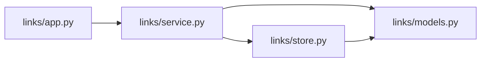

# Impact analysis

Source repository: `legacy_links` (analysed on a copy).

## Architecture (recovered from code)

| Role | Module |
|---|---|
| http | `links/app.py` |
| model | `links/models.py` |
| service | `links/service.py` |
| store | `links/store.py` |

## HTTP API surface
| Method | Path | Handler | Detected via |
|---|---|---|---|
| POST | `/links` | `links/app.py::create` | route table |
| GET | `/links/{code}` | `links/app.py::info` | dispatch |
| GET | `/{code}` | `links/app.py::redirect` | dispatch |

## Data model
- table `links`: code, target_url, created_at, clicks

## Data flows
- POST /links -> links/app.py::create -> links/service.py::shorten -> links/store.py::save [INSERT]
- GET /links/{code} -> links/app.py::info -> links/service.py::info -> links/store.py::get [SELECT]
- GET /{code} -> links/app.py::redirect -> links/service.py::resolve -> links/store.py::get [SELECT] -> links/store.py::increment_clicks [UPDATE]

## Change impact
Matched change patterns: fix_alias_overwrite, add_expiration

Directly impacted symbols:
- `links/app.py::create` (add_expiration, fix_alias_overwrite)
- `links/app.py::redirect` (add_expiration)
- `links/models.py::Link` (add_expiration)
- `links/service.py::LinkService.resolve` (add_expiration)
- `links/service.py::LinkService.shorten` (add_expiration, fix_alias_overwrite)
- `links/store.py::LinkStore.__init__` (add_expiration)
- `links/store.py::LinkStore.get` (add_expiration)
- `links/store.py::LinkStore.save` (add_expiration, fix_alias_overwrite)

Ripple (transitive callers):
- `links/app.py::app`
- `links/app.py::info`
- `links/app.py::make_app`
- `links/service.py::LinkService.info`

Impacted APIs: `GET /links/{code}`, `GET /{code}`, `POST /links`
Schema change: yes - `expires_at` column, online migration required

## Regression baseline
5/5 existing tests passing before any change (2 test module(s) form the regression scope).

Existing tests exercising impacted code (must stay green):
- `tests/test_service.py::test_clicks_are_counted`
- `tests/test_service.py::test_custom_alias`
- `tests/test_service.py::test_rejects_non_http`
- `tests/test_service.py::test_shorten_and_resolve`
- `tests/test_service.py::test_unknown_code`
