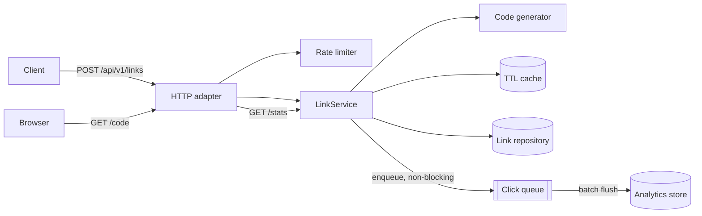

# Architecture: URL shortener service

**Style:** Hexagonal (ports & adapters) service; stateless app tier; storage behind ports

## Components
| Component | Responsibility |
|---|---|
| HTTP adapter (http.py) | Routing per OpenAPI contract, auth, rate limiting, problem+json errors |
| LinkService (service.py) | Business rules: validation, code allocation with collision retry, expiry, ownership |
| Code generator (codes.py) | CSPRNG base62 codes; no coordinator needed across instances |
| LinkRepository port (repository.py) | Atomic insert-if-absent; SQLite adapter (dev) / DynamoDB conditional put (prod) |
| TTLCache (cache.py) | In-process LRU+TTL with negative caching; ElastiCache in prod |
| ClickRecorder (analytics.py) | Bounded queue + batch flusher; never blocks redirects; Kinesis/Firehose in prod |
| AnalyticsStore | Raw events (retention-bounded) + pre-aggregated daily counters |
| TokenBucketLimiter (ratelimit.py) | Per-client write throttling; API Gateway usage plans / Redis in prod |

## Request flows
- **create**: client -> POST /api/v1/links -> auth -> rate limit -> validate URL/alias/TTL -> allocate code -> repository.insert (unique constraint) -> retry on collision (<=5) -> 201
- **redirect**: client -> GET /{code} -> cache (positive/negative) -> repository.get -> expired? 410 : disabled? 404 -> enqueue ClickEvent (non-blocking) -> 302
- **analytics**: flusher thread -> batch insert raw events + upsert daily counters (one transaction) -> GET /stats reads aggregates + bounded raw window

## Resolved design parameters (from requirements gate)
| Setting | Value |
|---|---|
| `allow_custom_alias` | `True` |
| `analytics_ip_mode` | `drop` |
| `analytics_retention_days` | `90` |
| `code_length` | `8` |
| `create_rate_per_min` | `20` |
| `default_ttl_days` | `180` |
| `require_api_key` | `True` |

## Scaling to production (AWS)
| Concern | Production design |
|---|---|
| Edge | CloudFront + WAF (bot/abuse rules) -> ALB |
| Compute | ECS Fargate service (stateless), autoscaled on p99 latency and CPU |
| Links store | DynamoDB on-demand, PK=code, ConditionExpression attribute_not_exists(code) |
| Cache | ElastiCache (Redis) read-through, 60s TTL, negative entries 5s |
| Click pipeline | Kinesis Data Streams -> Firehose -> S3 (Parquet) -> Athena; Lambda consumer for DynamoDB daily counters (atomic ADD) |
| Rate limiting | API Gateway usage plans or Redis token buckets |
| Observability | CloudWatch metrics: redirect p99, cache hit ratio, analytics backlog/drops, 5xx |

## Capacity estimate
- 1B links x ~500 B/item ~ 0.5 TB in DynamoDB; 10k redirects/s ~ 10k RCU-equivalents before cache
- With a 90% cache hit ratio the store sees ~1k reads/s; 100 creates/s is trivial for conditional puts
- Click events: 10k/s x ~150 B ~ 1.5 MB/s -> 2 Kinesis shards with headroom

## Key decisions (ADR summary)
### ADR-001 Short-code allocation
- **Chosen:** Random base62 (CSPRNG) + uniqueness constraint + bounded retry
- **Alternatives:** Global counter + base62; hash(url) truncation; pre-allocated key ranges (KGS)
- **Rationale:** No coordinator or hot counter, codes are unguessable (no enumeration), collisions are detectable atomically by the store. Cost: one extra write attempt in ~1e-3 cases at 1B links.

### ADR-002 Redirect status code
- **Chosen:** 302 Found
- **Alternatives:** 301 Moved Permanently
- **Rationale:** 301 is cached by browsers forever, so clicks after the first are invisible to analytics and disabling/expiring a link would not take effect. 302 costs one round-trip per click.

### ADR-003 Analytics write path
- **Chosen:** Asynchronous bounded queue, batch writes, drop on overload
- **Alternatives:** Synchronous write per redirect; exactly-once streaming
- **Rationale:** Redirect latency/availability is the product; analytics is best-effort. Drops are counted and exposed on /healthz so loss is observable, not silent.

### ADR-004 Analytics storage model
- **Chosen:** Raw events (bounded retention) + pre-aggregated daily counters
- **Alternatives:** Raw events only; aggregates only
- **Rationale:** Totals stay O(days) to query and survive raw-event purging (privacy/retention); raw window still supports referrer/UA breakdowns.

### ADR-005 Primary store
- **Chosen:** Key-value semantics behind a port (SQLite in prototype, DynamoDB in prod)
- **Alternatives:** Relational DB (Aurora) with sharding
- **Rationale:** Access pattern is single-key get/put at very high read volume; KV gives predictable latency and horizontal scale without sharding logic.

### ADR-006 Visitor privacy
- **Chosen:** Salted daily-rotating IP hash (or drop)
- **Alternatives:** Store raw IPs
- **Rationale:** Unique-visitor counts without retaining personal data or enabling cross-day tracking.

### ADR-007 Framework
- **Chosen:** Standard-library WSGI adapter
- **Alternatives:** FastAPI/Starlette
- **Rationale:** Zero runtime dependencies for the prototype and fully in-process tests; the adapter is thin (one module) and can be swapped without touching service or storage code.

