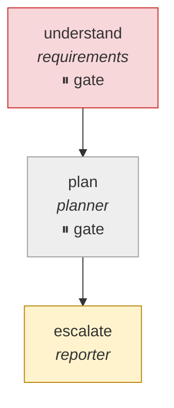

# Engineering summary - We need a link thing for our marketing campaigns

**Run:** `demo-ambiguous`  |  **Outcome:** ESCALATED TO HUMAN  |  **Scenario:** greenfield  |  **Domain:** url_shortener  |  **LLM:** none (deterministic agents)

**Escalations:** `understand`: rejected at gate 'requirements' by policy:auto: rejected by policy: Q1 (high) needs a human answer: This reads like a url shortener service but the wording is indirect. Confirm that is the intended system?

## 1. Requirement understanding

> We need a link thing for our marketing campaigns. It should be fast and secure, and it
should track stuff so the team can see how campaigns perform. Lots of users will hit it,
so keep it simple and reliable.

**Normalised:** Build a new URL shortener service: Reject unsafe or malformed target URLs; Click analytics per link; Rate limiting and API-key protection of write endpoints. Also assumed: 7 capabilities required for production use.

**Capabilities**
- Reject unsafe or malformed target URLs (stated)
- Click analytics per link (stated)
- Rate limiting and API-key protection of write endpoints (stated)
- Create a short link for a long URL (assumed)
- Resolve a short code and redirect (HTTP 302) (assumed)
- Optional custom alias (vanity code) (assumed)
- Optional link expiry (TTL) (assumed)
- Durable storage of links and analytics (assumed)
- Horizontal scalability of the redirect path (assumed)
- Versioned REST API with a published contract (assumed)

**Out of scope (v1):** User accounts / UI dashboard; Geo-IP enrichment; Custom domains per tenant; Malware/phishing reputation lookups (documented as production follow-up)

**Acceptance criteria**

| ID | Type | Criterion |
|---|---|---|
| AC-CREATE | functional | POST /api/v1/links with a valid http(s) URL returns 201 with a unique short code and short_url |
| AC-REDIRECT | functional | GET /{code} returns 302 with Location set to the original URL; unknown codes return 404 |
| AC-VALIDATE | security | Non-http(s), credential-bearing, local or private-network target URLs are rejected with 422 |
| AC-ALIAS | functional | A custom alias can be requested; a taken alias returns 409 and never overwrites the existing link |
| AC-EXPIRY | functional | Links may carry a TTL; expired links return 410 Gone |
| AC-PERSIST | functional | Links and analytics survive a process restart |
| AC-ANALYTICS | functional | Every redirect records a click; the stats endpoint returns totals, per-day counts, top referrers and user-agent classes |
| AC-PRIVACY | security | Raw client IPs and full referrer URLs are never stored; raw events are purgeable after the retention window |
| AC-CONCURRENCY | nfr | Code allocation is collision-safe under concurrent writers (no duplicate codes, no lost or overwritten links) |
| AC-HOTPATH | nfr | Redirects are served from cache after first access and analytics recording never blocks or fails a redirect |
| AC-ABUSE | security | Link creation is rate limited per client (429 + Retry-After); write endpoints require an API key when configured; only owners can disable a link |
| AC-CONTRACT | functional | The HTTP API conforms exactly to the published OpenAPI contract; errors use application/problem+json |

### Ambiguities and resolutions

| ID | Severity | Trigger | Question | Resolution | Source |
|---|---|---|---|---|---|
| Q1 | high | domain | This reads like a url shortener service but the wording is indirect. Confirm that is the intended system? | Build a url shortener service. | default assumption |
| Q2 | medium | Lots of users | 'Lots of users' is not measurable. What peak redirect throughput and total link volume must the service support? | Design target 10k redirects/s peak, 100 creates/s, ~1B links over 5 years (read:write ~ 100:1). The prototype is sized for one node; the design scales out. | default assumption |
| Q3 | medium | fast | 'fast' is not measurable. What latency objective applies to redirects? | p99 redirect latency < 50 ms inside the service (cache hit < 5 ms). | default assumption |
| Q4 | medium | reliable | 'reliable' is not measurable. What availability target applies, and may link creation degrade before redirects? | 99.95% for redirects; creation and analytics may degrade first (analytics is best-effort and must never block redirects). | default assumption |
| Q5 | medium | secure | 'secure' is not measurable. Who may create and delete links? Is an API key required for write endpoints? | Write endpoints require an API key (X-API-Key); redirects and stats are public. | default assumption |
| Q6 | medium | secure | 'secure' is not measurable. Which visitor data may analytics store? (raw IPs are personal data under GDPR) | Never store raw IPs: keep a salted, daily-rotating hash for unique-visitor counts. | default assumption |
| Q7 | medium | track stuff | 'track stuff' is not measurable. How long must raw click events be retained? | Raw click events 90 days; daily aggregates kept for the life of the link. | default assumption |
| Q8 | medium | track stuff | 'track stuff' is not measurable. Which analytics are required (clicks, uniques, referrers, devices, geography)? | Total and daily clicks, unique visitors, top referrer hosts, user-agent class. Geo-IP is out of scope for v1 (needs a licensed database). | default assumption |
| Q9 | medium | secure | 'secure' is not measurable. What creation rate per client is acceptable before throttling? | 60 link creations per minute per API key (or per IP when keys are disabled). | default assumption |
| Q10 | low | short-code format | How long may short codes be, and must they be unguessable? | 7-character random base62 codes (62^7 = 3.5e12), unguessable, no sequential IDs. | default assumption |
| Q11 | low | default expiry | Should links expire by default? If so after how many days? | Links never expire unless the caller sets ttl_seconds. | default assumption |
| Q12 | low | custom aliases | Are caller-chosen custom aliases allowed? | Yes - custom aliases allowed, first-come-first-served, never overwritten. | default assumption |
| Q13 | medium | stuff | The requirement uses open-ended wording ('stuff'). What exactly is in scope? | Scope is limited to the capabilities listed in the normalised requirement. | default assumption |
| Q14 | low | simple | 'simple' is subjective. What observable property should it translate to? | Interpreted as: documented API, consistent errors, sensible defaults. | default assumption |

Resolved settings fed to generation: `allow_custom_alias=True`, `analytics_ip_mode=hash`, `analytics_retention_days=90`, `code_length=7`, `create_rate_per_min=60`, `default_ttl_days=0`, `require_api_key=True`

## 2. Implementation plan and rationale

| Task | Agent | Depends on | Status | Attempts | ms | Notes |
|---|---|---|---|---|---|---|
| `understand` | requirements | - | failed | 1 | 11 | kind=greenfield domain=url_shortener confidence=0.33; 3 stated / 7 assumed capabilities, 14 ambiguities, 12 acceptance criteria; rejected at gate 'requirements' by policy:auto: rejected by policy: Q1 (high) needs a human |
| `plan` | planner | understand | skipped | 0 | 0 | upstream failure |
| `escalate` | reporter | plan | running (this report) | 1 | 0 |  |

## 3. Orchestration trace

- 2 task executions, max parallelism 1, 0 transient retries, 0 repair cycle(s), 1 human/policy gate decisions

| t (s) | Event | Detail |
|---|---|---|
| 0.014 | gate_decided | gate=requirements, approved=False, by=policy:auto, comment=rejected by policy: Q1 (high) needs a human answer: This reads like a url shortener service but the wording is indirect. |
| 0.015 | task_failed | task=understand, error=rejected at gate 'requirements' by policy:auto: rejected by policy: Q1 (high) needs a human answer: This reads like a url shortener service but the wording is indirect. Confirm that is the intended system? |
| 0.018 | task_skipped | task=plan, reason=upstream failure |

Full machine-readable trace: `trace.jsonl`.

## 5. Generated artifacts

| Path | Produced by | Lines | sha256 |
|---|---|---|---|

## 6. Validation results

Validation did not complete (see escalations).

## 7. Risks, trade-offs and failure scenarios

| ID | Risk | Likelihood | Impact | Mitigation |
|---|---|---|---|---|

## 8. Validation approach

## 9. Assumptions and limitations

- Assumed (Q1): Build a url shortener service.
- Assumed (Q2): Design target 10k redirects/s peak, 100 creates/s, ~1B links over 5 years (read:write ~ 100:1). The prototype is sized for one node; the design scales out.
- Assumed (Q3): p99 redirect latency < 50 ms inside the service (cache hit < 5 ms).
- Assumed (Q4): 99.95% for redirects; creation and analytics may degrade first (analytics is best-effort and must never block redirects).
- Assumed (Q5): Write endpoints require an API key (X-API-Key); redirects and stats are public.
- Assumed (Q6): Never store raw IPs: keep a salted, daily-rotating hash for unique-visitor counts.
- Assumed (Q7): Raw click events 90 days; daily aggregates kept for the life of the link.
- Assumed (Q8): Total and daily clicks, unique visitors, top referrer hosts, user-agent class. Geo-IP is out of scope for v1 (needs a licensed database).
- Assumed (Q9): 60 link creations per minute per API key (or per IP when keys are disabled).
- Assumed (Q10): 7-character random base62 codes (62^7 = 3.5e12), unguessable, no sequential IDs.
- Assumed (Q11): Links never expire unless the caller sets ttl_seconds.
- Assumed (Q12): Yes - custom aliases allowed, first-come-first-served, never overwritten.
- Assumed (Q13): Scope is limited to the capabilities listed in the normalised requirement.
- Assumed (Q14): Interpreted as: documented API, consistent errors, sensible defaults.
- Generation ran with deterministic agents and a curated domain pack; an LLM provider (SDLC_LLM) is only needed for domains without a pack.
- Prototype adapters are single-node (SQLite, in-process cache and rate limiter); production adapters are specified in docs/architecture.md, not implemented.

## 10. Human oversight log

| Gate | Decision | By | Comment |
|---|---|---|---|
| requirements | rejected | policy:auto | rejected by policy: Q1 (high) needs a human answer: This reads like a url shortener service but the wording is indirect. Confirm that is the intended system? |
